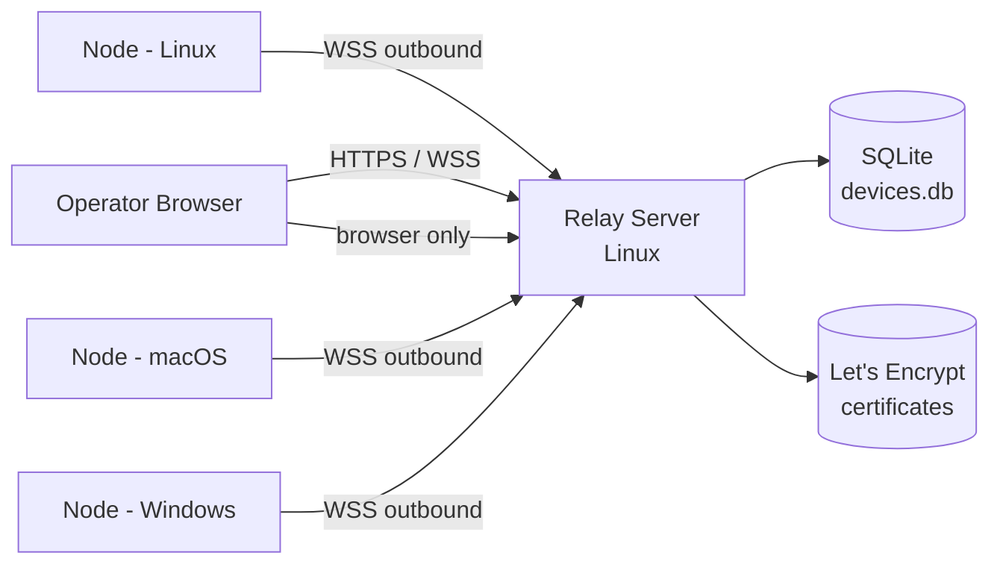
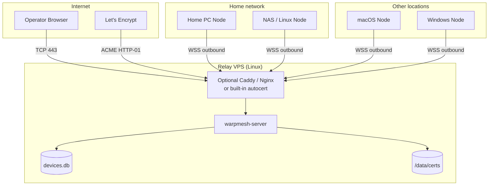
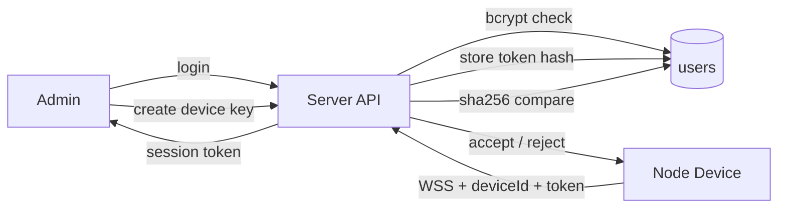
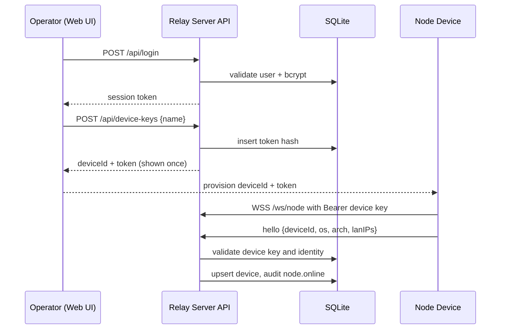
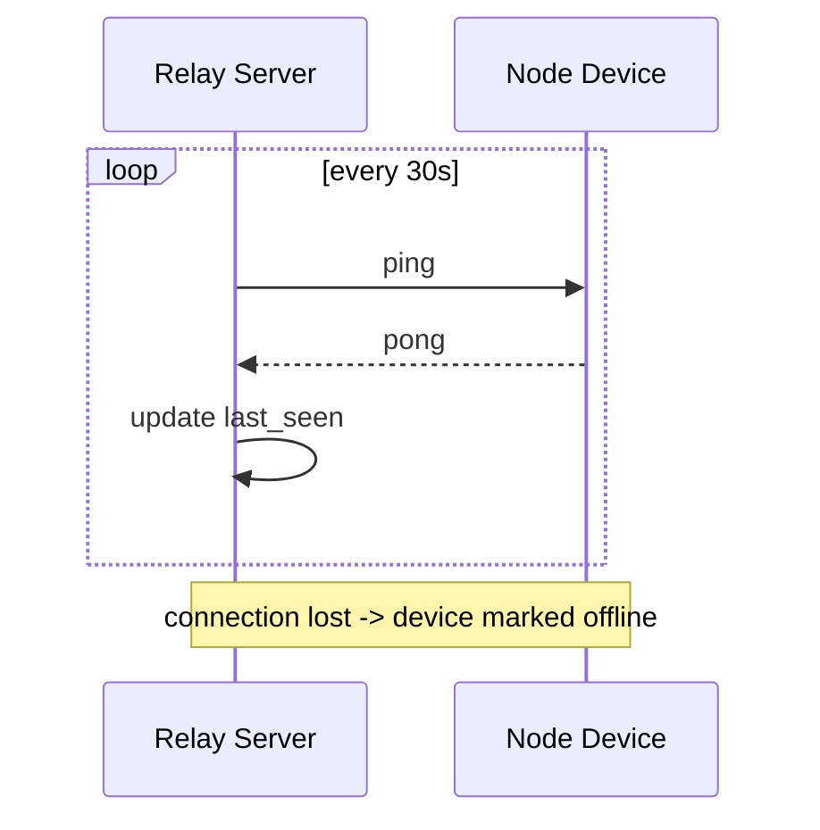
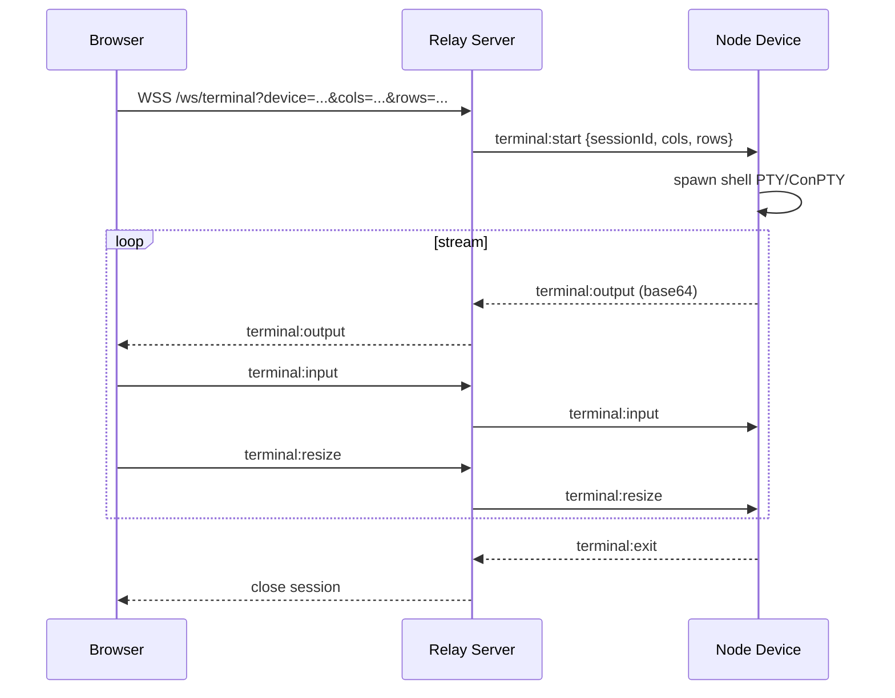
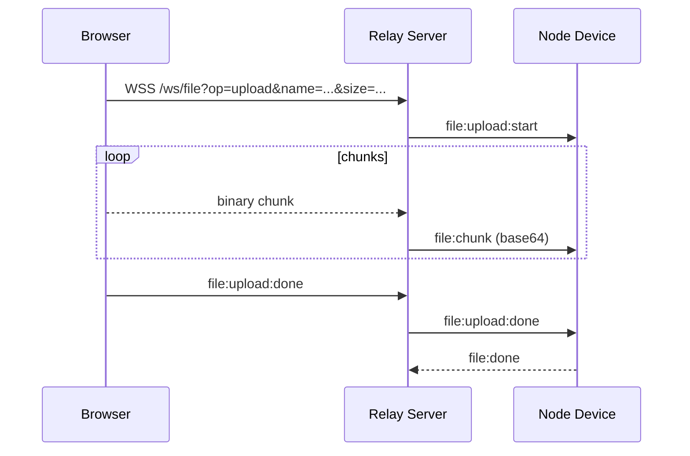
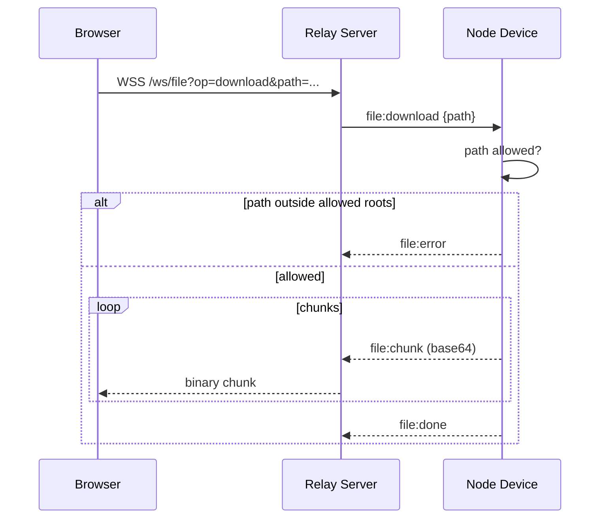
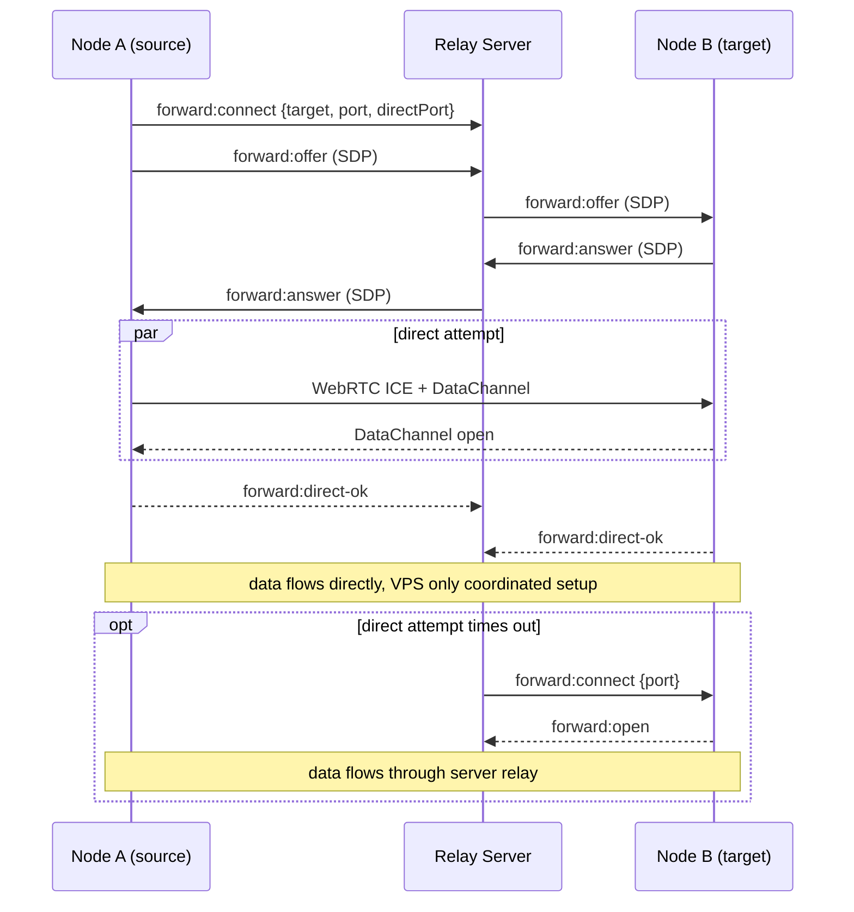
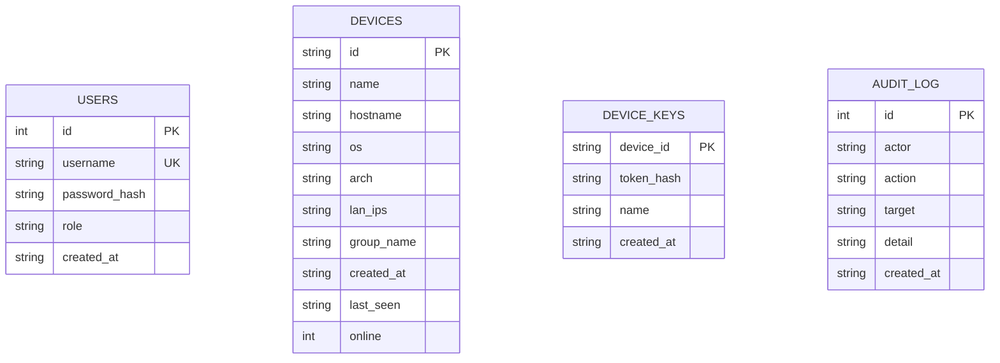

# WarpMesh Architecture

WarpMesh is a self-hosted control plane for a fleet of devices behind NAT.
It combines a Linux relay server, outbound device nodes and a browser-based
management console. This document describes the design so the project can be
understood, extended and audited without reading every source file.

## 1. Design Goals

- Devices without public IPs can be reached from anywhere through one relay.
- Browser access remains the zero-install path; the Windows client is an
  optional native shell over the same server-enforced workflows.
- Nodes connect outbound, so no inbound firewall rules or port forwarding are
  required on the managed devices.
- The control plane is self-hosted, persists state in SQLite and keeps an
  audit trail of security-relevant actions.
- The server targets Linux with no CGO dependency; nodes run on Linux, macOS
  and Windows.

## 2. Component Overview



The runtime components are:

| Binary | Platform | Responsibility |
| --- | --- | --- |
| `warpmesh-server` | Linux | HTTP API, WebSocket relay, static web UI, SQLite persistence, certmagic-managed Let's Encrypt |
| `warpmesh-node` | Windows / macOS / Linux | Outbound registration, heartbeat, PTY/ConPTY terminal, file transfer |
| `warpmesh-client.exe` | Windows | WebView2 shell for the loopback node UI and the server control plane |
| Web UI | embedded into server | Dashboard, device management, terminal, file transfer, device keys |

## 3. Deployment



Recommended deployment:

```bash
./bin/warpmesh-server \
  -domain relay.example.com \
  -acme-email you@example.com \
  -data-dir /var/lib/warpmesh
```

TCP 80 and 443 must be open. The server redirects HTTP to HTTPS and
automatically renews certificates.

By default the web console, browser WebSockets, node control plane and
screen-link data plane share the primary listener (443 for built-in HTTPS).
An optional `DEVICE_RELAY_ALT_HTTPS_LISTEN` separates the node control plane
and screen-link data plane onto another HTTPS port. Plain HTTP mode uses the
configured HTTP listener for all routes. Nodes discover the active node port
via `/api/node-config` and never hardcode it.

## 4. Authentication and Access Model



There are two credential paths:

1. Operator sessions: username/password is checked with bcrypt and produces a
   24-hour session token. Browsers use an HttpOnly, SameSite=Strict cookie;
   logout revokes the server-side session, not just the cookie. CLI clients may
   use Bearer authentication. The static `DEVICE_RELAY_ADMIN_TOKEN` remains
   available for administration.
2. Device credentials: each device gets a unique key. The plaintext token is
   returned once at creation and only its SHA-256 hash is stored. A node must
   present that device's key and identity; a shared token is not sufficient.

## 5. Device Registration Sequence



## 6. Keepalive



On server restart, all devices start offline. The first valid hello from a
node brings the device back online, so liveness never lies.

## 7. Remote Terminal

The node runs a real PTY (Unix) or ConPTY (Windows) shell. The browser uses a
server WebSocket for authorization and signaling, then attempts a direct
WebRTC DataChannel. Negotiation has a 20-second budget, including asynchronous
offer creation. Failure or timeout switches to the server relay shown below;
initial shell output does not prove a direct connection or cancel the budget.



Terminal output is base64 encoded because PTY output is not guaranteed to be
valid UTF-8. Browser input is sent as JSON text and written to the PTY as
bytes.

## 8. File Transfer

Upload direction:



Download direction:



The node rejects upload/download paths outside its configured roots (home
directory by default). Files are opened through `os.Root` so symlinks or path
replacement cannot escape the selected root during the actual open operation.
Uploads use 64 KiB browser Blob slices with send-queue backpressure; success is
reported only after the node closes the file and sends `file:done`. A failure
or cancellation may leave a partial file because uploads are not atomic.
Browser file requests reject on disconnect, cancellation or 60 seconds of
inactivity. Downloads currently assemble a Blob in memory and reject payloads
above 128 MiB; larger files require another transfer tool.

## 9. Device-to-Device Forwarding

Nodes can expose a local TCP listener that reaches a port on another device.
The direct path uses WebRTC/ICE with STUN: nodes exchange SDP and ICE
candidates through the server, then try to establish a peer-to-peer
DataChannel. If no direct path is found in 5 seconds, the server falls back to
relaying through itself. This keeps VPS bandwidth usage low while still
guaranteeing connectivity through restrictive NATs.



The implementation is built on pion/webrtc, the mature Go WebRTC stack also
used by many production remote-control products. Symmetric NATs that cannot be
traversed without TURN automatically fall back to the server relay.

## 10. Local Automation Surface

The node's local web UI is backed by a versioned JSON API under `/api/v1`.
Every link-management operation shown in the UI has a matching tool definition
with JSON Schema input and safety annotations. The same definitions are served
by `GET /api/v1/capabilities` and by the `warpmesh-node mcp` stdio server.
The operating contract is embedded from `AI_GUIDE.md` and served as
`GET /api/v1/ai-guide`, the MCP resource `warpmesh://node/guide`, and the
`warpmesh-node ai-guide` CLI command.

Automation requests are loopback-only and require a 256-bit bearer token stored
as `ui-token` in the node data directory. The file is created with owner-only
permissions. The capability manifest is public on loopback so clients can
discover the schema before obtaining the token.

Terminal, desktop, file and server-policy actions are represented by stable
console deep links. They still pass through server authentication and
per-device authorization; a local automation token cannot grant remote access.

The control plane exposes its own REST discovery document at
`/api/automation/capabilities`. It uses the normal operator session or Bearer
credential and lists all device, account, credential, invite, analytics, audit
and forwarding-grant operations together with their access level.
Its authenticated operating guide is at `/api/automation/ai-guide`.

## 11. Controlled Node Updates

The Server publishes only Node releases that already exist in its configured
Node directory. An administrator starts an update with a device ID; the Server
derives the platform, version and SHA256 from that package and sends a task over
the authenticated Node WebSocket. The Node downloads from a fixed authenticated
Server route into `data/updates`, verifies the digest, executes `version` on the
staged binary, and reports every state transition.

Unix Nodes configured for a concrete systemd service replace the executable
atomically, restart that service, and restore `.previous` if the service does
not become active. Windows and manually supervised Nodes stop at `staged`
because replacing a running executable or guessing a service manager would be
unsafe. The Server marks an update `succeeded` only after the restarted Node
reconnects and reports the target version.

## 12. Remote Desktop

Remote desktop does not reimplement screen capture or encoding. The managed
device runs a VNC server bound to localhost (TigerVNC, TightVNC or similar),
the WarpMesh node bridges that VNC port into a dedicated WebSocket, and the web
console embeds noVNC. The operator only needs a browser.

```mermaid
sequenceDiagram
    participant B as Browser (noVNC)
    participant S as Relay Server
    participant A as Node Device
    participant V as VNC Server (localhost)

    B->>S: WSS /ws/screen?device=...
    S->>A: screen:start
    A->>S: WSS /ws/screen-link (data plane)
    A->>V: TCP 127.0.0.1:5900
    Note over B,S,A,V: binary RFB frames relayed end to end
```

The node defaults to port 5900 and can be changed with `-vnc-port`.

## 13. Data Model



Operator sessions are kept in server memory with a 24-hour expiry. Everything
else is persisted in `devices.db`.

## 14. Protocol

All control traffic is JSON over WebSocket. The envelope is:

```json
{
  "type": "terminal:output",
  "sessionId": "...",
  "data": "base64..."
}
```

| Type | Direction | Purpose |
| --- | --- | --- |
| `hello` | node -> server | register device metadata |
| `ping` / `pong` | both | keepalive |
| `terminal:start` | server -> node | open a shell session |
| `terminal:output` | node -> server -> browser | PTY/ConPTY output |
| `terminal:input` | browser -> server -> node | keystrokes |
| `terminal:resize` | browser -> server -> node | window resize |
| `terminal:stop` / `terminal:exit` | both | end a session |
| `file:upload:start` | server -> node | begin upload |
| `file:chunk` | both | base64 payload |
| `forward:connect` | source node -> server, server -> target | begin device-to-device forwarding |
| `forward:offer` / `forward:answer` | both | WebRTC SDP signaling through the server |
| `forward:ice` | both | WebRTC ICE candidate exchange |
| `screen:start` | server -> node | open the remote desktop data link |
| `screen:error` | node -> server | remote desktop setup failed |
| `forward:direct-ok` | node -> server | direct connection established |
| `forward:open` / `forward:data` / `forward:close` | both | relayed device-to-device stream |
| `file:upload:done` / `file:done` / `file:error` | both | finish or fail |
| `file:download` | server -> node | read a device path |

## 15. Security Properties

- Operator and device credentials are separated.
- Device tokens are stored as SHA-256 hashes and shown once at creation.
- WebSocket connections validate the `Origin` header for browsers.
- Failed authentication and security-relevant actions are recorded in the
  audit log.
- Login failures are rate limited per username and client IP, and sessions can
  be invalidated explicitly with `POST /api/logout`.
- File downloads are constrained to allowed paths.
- HTTPS is provided by automatic Let's Encrypt, manual certificates or a
  reverse proxy.
- Default deployment does not expose plain HTTP beyond localhost.

## 16. Directory Layout

```text
cmd/server/            server entrypoint (HTTP, HTTPS/ACME)
cmd/node/              node entrypoint (CLI flags)
cmd/windowsclient/     native Windows WebView2 client
internal/server/       API, WebSocket relay, SQLite registry
internal/node/         outbound node, terminal sessions, file transfer
internal/protocol/     shared JSON message types
web/                   React + TypeScript console (embedded into server)
docs/architecture.md   this document
```

## 17. Extension Points

- UDP-based hole punching for symmetric NAT support.
- Remote desktop via a node-side screen streaming endpoint.
- User roles and per-device access policies.
- Power actions (reboot, shutdown) and node updates.
- Persistent session recording for audit replay.
