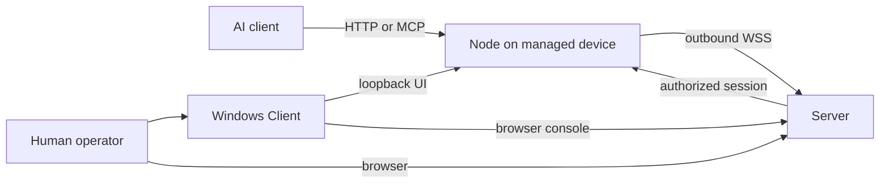

# Server, Client, Node

WarpMesh has three runtime roles. The separation keeps device operations local
and authorization central.



## Server

Server is the control plane. It stores devices, accounts, keys, invites,
forwarding grants and audit events. It also relays sessions that cannot use a
direct peer path.

Build and start:

```bash
make server
DEVICE_RELAY_ADMIN_TOKEN="$(openssl rand -hex 24)" \
DEVICE_RELAY_ADMIN_PASSWORD='<strong-password>' \
./bin/warpmesh-server \
  -domain warpmesh.example.com \
  -data-dir ./data
```

Open the configured HTTPS URL and sign in with the admin account. Use:

- **Devices** to inspect nodes, access terminals/desktops/files and change policy.
- **Access** to create accounts, device keys, invites and link grants.
- **Activity** to inspect security-relevant events.

Server management is available to AI clients through:

```text
GET /api/automation/capabilities
GET /api/automation/ai-guide
Authorization: Bearer <admin-or-session-token>
```

An operator account can only perform actions allowed by its device grants.
Admin-only APIs return `403` for operator credentials.

## Node

Node is the service installed on a managed device. It connects outbound to
Server, exposes terminal/file/desktop capabilities and owns local TCP links.

Enroll a device with an invite created in the Server console:

```bash
warpmesh-node enroll \
  -server https://warpmesh.example.com \
  -code <invite-code> \
  -name workstation \
  -data-dir ./data
```

Start the Node:

```bash
warpmesh-node \
  -server https://warpmesh.example.com \
  -data-dir ./data \
  -ui-port 9876
```

The local console is at `http://127.0.0.1:9876`. It exposes:

- connection and service readiness
- TCP links and peer endpoint mappings
- terminal, desktop, files and Server authorization entry points
- diagnostics
- HTTP and MCP automation capabilities

Node AI controls:

```bash
warpmesh-node ai-guide
warpmesh-node automation -data-dir ./data
warpmesh-node mcp -data-dir ./data
```

The local Node token is stored as `data/ui-token`. It manages only that Node.
It is not a Server credential and cannot bypass account or device grants.

## Node Updates

Server can update an online Node only from releases already placed in its
configured Node directory. The Server derives version and SHA256 from the
package, sends an authenticated task over the existing Node WebSocket, and
records download, verification, staging, restart and success/failure states.

For a supervised Unix service:

```bash
# Server
... ./bin/warpmesh-server -node-dir /opt/warpmesh/nodes \
  -update-service warpmesh-node.service

# Node
./warpmesh-node ... -update-service warpmesh-node.service
```

If `-update-service` is omitted, discovery can fill it from `/api/node-config`
when the Server has it configured. Windows and manually launched Nodes stop at
`staged`; use the Windows service manager or the `warpmesh-client.exe` release
process to restart/update the desktop layer separately.

## Client

Client is the Windows desktop shell. It assumes the Node service is already
running on the same machine.

1. Start `warpmesh-node` with the local UI enabled.
2. Launch `warpmesh-client.exe`.
3. The Client waits for `http://127.0.0.1:9876`, then renders the local Node console.
4. Use **Control plane** or the Access actions to open the Server console.

Useful launch options:

```powershell
.\warpmesh-client.exe -node-url http://127.0.0.1:9876
.\warpmesh-client.exe -debug
```

If WebView2 is unavailable, Client opens the local Node UI in the default
browser. Closing Client does not stop Node or Server.

Client pages:

| Page | Purpose |
| --- | --- |
| Overview | Node health, services and recent links |
| Links | Create, update, copy and delete local TCP links |
| Peers | Inspect remote device and port mappings |
| Access | Open terminal, desktop, files and Server policy |
| Automation | HTTP/MCP discovery and tool definitions |
| Diagnostics | Runtime details and copyable JSON |

## Access Boundary

Local Node controls answer "what can this device do?" Server authorization
answers "what may this user or AI client access?"

Do not put credentials in URLs. Do not treat a visible terminal or desktop link
as authorization. Do not use the Node token for Server APIs.
